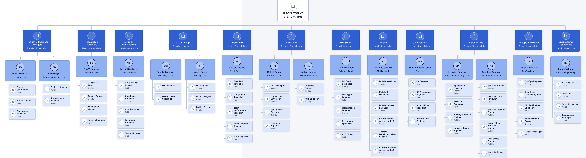
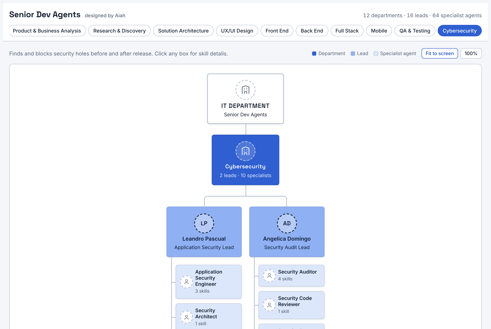
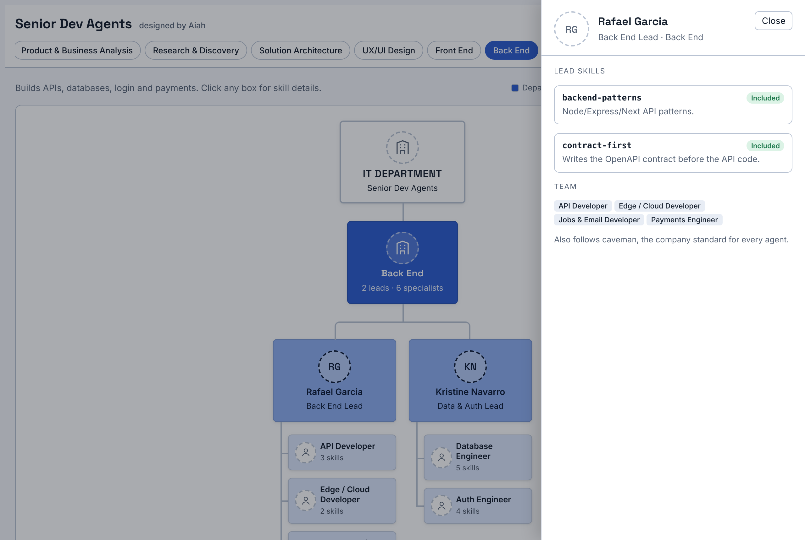

# Senior Dev Agents

**An AI software team for Claude Code, designed like a real IT company.**

I built Senior Dev Agents to give myself a full dev team I can call on from one place: people who understand a tool, scope it, design it, build it, test it, secure it and ship it. It's organized into **12 departments, 16 team leads and 64 specialist agents**, backed by **137 skills and 10 reviewer agents**, and it installs into Claude Code as a single plugin.



**[Explore the interactive org chart →](https://claude.ai/artifact/QkF4Phd7LoPu1F9aGTgXJU)** Click any department or agent to see its skills. A copy is in [`docs/org-chart.html`](docs/org-chart.html).

## Why I built it

AI coding tools are powerful, but out of the box they behave like one generalist. I wanted a team with clear roles and an order of work, so that:

- **Nothing gets built before it's understood and scoped.** Product, research and architecture come first.
- **Security is a department, not an afterthought.** Every change gets an application-security pass and an audit before release.
- **Every project starts from the same foundation.** A default tech stack, house rules and reviewers are shared across everything I build: websites, a SaaS tool, and mobile, desktop and web apps.

## How the team works

Work moves through the departments in build order. Each department has named leads, and each lead runs a group of specialist agents with their own skills.

| Stage | Departments |
|---|---|
| Understand and scope | Product & Business Analysis, Research & Discovery |
| Design | Solution Architecture, UX/UI Design |
| Build | Front End, Back End, Full Stack, Mobile |
| Prove and protect | QA & Testing, Cybersecurity |
| Ship | DevOps & Release |
| Oversee | Engineering Leadership (Senior Dev) |

<table>
<tr>
<td width="50%"><br><sub>Each department has its own view. Cybersecurity has two leads and ten specialists.</sub></td>
<td width="50%"><br><sub>Clicking an agent shows its skills and what each one does.</sub></td>
</tr>
</table>

## What I designed

- **The org structure:** 12 departments, 16 leads and 64 roles, each mapped to the skills that agent needs. See [`docs/team-hierarchy.md`](docs/team-hierarchy.md) and [`docs/team-skills-table.md`](docs/team-skills-table.md).
- **The default tech stack** every tool starts from: TypeScript; Cloudflare for hosting, edge and security; Next.js; Neon Postgres with Prisma; Better Auth; Stripe; Resend; Expo; Vitest and Playwright; GitHub Actions; and Sentry. It's matched to the skills the team actually has. See [`docs/default-tech-stack.md`](docs/default-tech-stack.md).
- **The house rules** in [`CLAUDE.md`](CLAUDE.md) and the `senior-dev-team` skill: scope before building, a security pass before release, small, safe changes, and nothing installed without approval.
- **The selection and safety review:** I evaluated dozens of open-source agent-skill repositories, kept the strongest and removed duplicates. I rejected anything that scraped social sites, reused browser logins, added tracking or ran hidden hooks. The team ships as plain skill files, with no hooks, MCP servers, settings changes or telemetry.
- **The packaging:** a Claude Code plugin with its own private marketplace, so one command installs the whole team on any machine.

## Install

In Claude Code, run:

```
/plugin marketplace add aiahman/senior-dev-agents
/plugin install senior-dev-agents@senior-dev-agents
```

Restart Claude Code. Skills appear as `senior-dev-agents:<skill>` (for example `senior-dev-agents:security-review`), and the agents appear in `/agents`. To update, run `/plugin marketplace update senior-dev-agents`.

While the repository is private, the computer needs GitHub access (`gh auth login`).

A few skills include scripts that run only when an agent uses that skill, and Claude Code asks before running them. The codeql and semgrep skills need those scanners installed. BMAD needs a one-time setup per project: ask for the `bmad` skill and it creates a `_bmad/` folder.

## Repository layout

| Path | What it is |
|---|---|
| `skills/` | 137 skills, including `senior-dev-team` (the team rules) |
| `agents/` | 10 reviewer and auditor agents |
| `.claude-plugin/` | Plugin and marketplace files |
| `docs/` | Org chart, skills table, tech stack and screenshots |
| `THIRD_PARTY_NOTICES.md`, `licenses/` | Credits and licenses for every skill source |

## Credits

The individual skills come from open-source projects, used under their licenses and credited in [`THIRD_PARTY_NOTICES.md`](THIRD_PARTY_NOTICES.md). They include addyosmani/agent-skills, Trail of Bits, Cloudflare, BMAD Method, Expo, Stripe, Prisma, Neon, Resend, Hono, Inngest, obra/superpowers, mattpocock/skills, affaan-m/ECC, caveman, ui-ux-pro-max, REA and others. The team design, stack, rules, curation and packaging are my own work.
